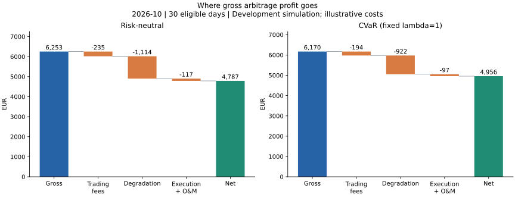
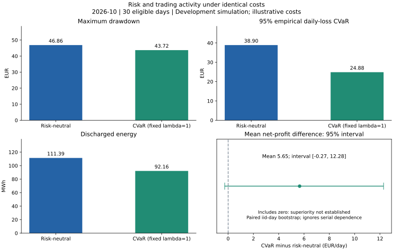
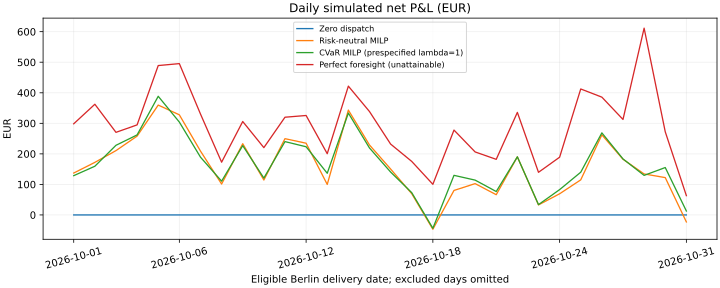
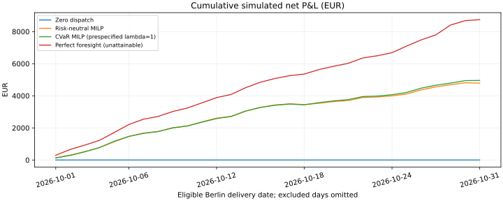
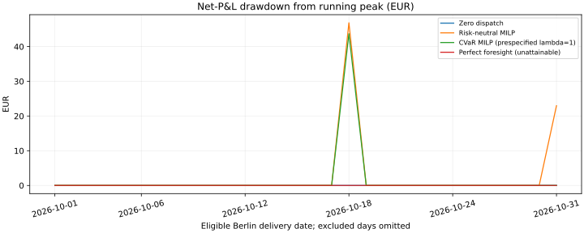
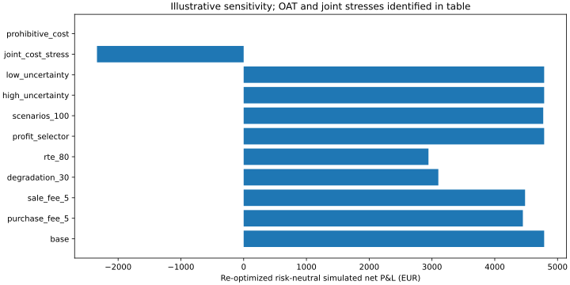

# Executed commercial backtest: October 2026

Executed on 23 November 2026 using the original validated historical artifact.
This is a development-period historical simulation, not live revenue or untouched holdout evidence.
No November result or multi-month empirical selection result is claimed.

## Provenance and validation

- Source: Energy-Charts / Bundesnetzagentur DE-LU prices, repository artifact
  `DE-LU-validated-months`, run 42305243042, artifact 13545788220. Original source terms apply.
- Historical CSV SHA-256: `1ea64b505b98063888fe262aaeb316778d422869e9be3a4e608953e4bf59f275`.
- 30 eligible October delivery days; 25 October (100-interval DST day) excluded.
- Baseline: 68 tests, three Python 3.14 CLI-help failures. Final suite: 88 tests passed.
- Independent audit: 2310 commercial schedules plus 210 zero-cost schedules passed cashflow, physical and oracle-bound checks.
- Maximum commercial cashflow discrepancy: 5.68e-13 EUR; maximum energy-balance residual: 2.03e-13 MWh.
- Exact configurations, package versions, execution timestamps and working-tree Git provenance:
  [compact executed evidence](commercial_results/summary.json). Full schedules are in the local
  `output/commercial/results.json` artifact and can be regenerated with the commands below.

## Illustrative assumptions

Battery: 2 MWh / 1 MW; 95% charge and discharge efficiency; initial/terminal energy 1 MWh.
Base costs: purchase fee 1 EUR/MWh, sale fee 1 EUR/MWh, execution 0.5 EUR/MWh on each side,
discharge degradation 10 EUR/MWh, legacy variable O&M zero. These are not verified tariffs or asset costs.
Risk-aware comparison is prespecified lambda=1; all five candidate lambdas are retained in JSON.

## Gross-to-net reconciliation (EUR)



| Strategy | Gross | Trading fees | Degradation | Other variable | Net |
| --- | ---: | ---: | ---: | ---: | ---: |
| Idle | 0.00 | 0.00 | 0.00 | 0.00 | 0.00 |
| Risk-neutral | 6253.14 | 234.81 | 1113.90 | 117.41 | 4787.02 |
| CVaR lambda=1 | 6169.52 | 194.28 | 921.63 | 97.14 | 4956.47 |
| Unattainable oracle | 10257.57 | 242.74 | 1151.49 | 121.37 | 8741.97 |

## Realized daily risk



| Strategy | Mean EUR/day | Worst net loss EUR | Negative days | Max drawdown EUR | 95% loss CVaR EUR | Discharge MWh |
| --- | ---: | ---: | ---: | ---: | ---: | ---: |
| Risk-neutral | 159.57 | 46.86 | 2 | 46.86 | 38.90 | 111.390 |
| CVaR lambda=1 | 165.22 | 43.72 | 1 | 43.72 | 24.88 | 92.163 |
| Unattainable oracle | 291.40 | 0.00 | 0 | 0.00 | -75.50 | 115.149 |

CVaR above is the exact fractional-mass upper tail of daily net losses, not the old threshold-tail average or optimization scenario CVaR.
The paired iid-day 95% bootstrap interval for lambda=1 minus risk-neutral mean daily net P&L is [-0.27, 12.28] EUR/day.
This ignores serial dependence; month-block inference is withheld (one observed month). No independent economic superiority is established.







## Re-optimized sensitivity

| Case | Design | Risk-neutral net EUR | Lambda=1 net EUR | Neutral idle days |
| --- | --- | ---: | ---: | ---: |
| base | baseline | 4787.02 | 4956.47 | 0 |
| purchase_fee_5 | one_at_a_time | 4447.86 | 4466.08 | 0 |
| sale_fee_5 | one_at_a_time | 4482.83 | 4522.82 | 0 |
| degradation_30 | one_at_a_time | 3101.28 | 3093.92 | 0 |
| rte_80 | one_at_a_time | 2944.09 | 3041.48 | 0 |
| profit_selector | one_at_a_time | 4787.02 | 4956.47 | 0 |
| scenarios_100 | one_at_a_time | 4772.09 | 5024.12 | 0 |
| high_uncertainty | one_at_a_time | 4787.02 | 4901.36 | 0 |
| low_uncertainty | one_at_a_time | 4787.02 | 4971.87 | 0 |
| joint_cost_stress | joint_stress | -2336.82 | -466.22 | 0 |
| prohibitive_cost | one_at_a_time | 0.00 | 0.00 | 30 |



The profit-selector row cannot evaluate prior-month selection with only one month; its equality with the base is by construction.
Uncertainty stresses change generated paths, not realized prices. Historical regime strata use ex-post daily volatility and prior-data thresholds; see JSON/HTML for sample counts.
The prohibitive-cost case explicitly tests when idle becomes economically preferable. It is not an estimate of real degradation cost.

## Original zero-cost evidence

The rerun reproduced risk-neutral 6308.94 EUR, lambda=1 6368.11 EUR and lambda=2 6371.48 EUR to the published cent.
Lambda=0.5 was 6238.30 EUR versus the documented 6238.28 EUR (a roughly two-cent numerical difference; exact replication is not claimed).
Original documents and plots were not overwritten. Solver/library versions and numerical tolerances can affect degenerate MILP schedules; the cause of this small difference was not isolated.

## Reproduce

```bash
python -m pip install -r requirements.txt
python -m unittest discover -s tests -t . -v
python -m scripts.run_commercial_backtest --history input/history/prices_DE-LU_2025-10_to_2026-10.csv --config config/zero_cost.json --output-dir output/zero_cost
python -m scripts.run_commercial_backtest --history input/history/prices_DE-LU_2025-10_to_2026-10.csv --config config/commercial.example.json --output-dir output/commercial
python -m scripts.audit_commercial_results --results output/commercial/results.json --history input/history/prices_DE-LU_2025-10_to_2026-10.csv
```

Use new output directories for subsequent runs; existing numerical artifacts are protected.

## Remaining limitations

- No untouched multi-month empirical evaluation or empirical selector comparison; November remains incomplete.
- October was used in development; 30 daily observations and 50/100 scenarios give fragile tail estimates.
- Source publication vintages and revisions are unverified; pre-auction tradability is not established.
- Forecast calibration weaknesses documented in the original October audit remain; this upgrade does not validate scenario tails.
- Unsupported 92/100-interval dispatch days; daily cyclic SOC; fixed historical residual folds.
- Illustrative costs/asset parameters, linear degradation only; no capex, fixed O&M, financing, taxes, imbalance, outages, network constraints or market impact.
- Local tests passed; hosted GitHub Actions for this branch have not been executed.
